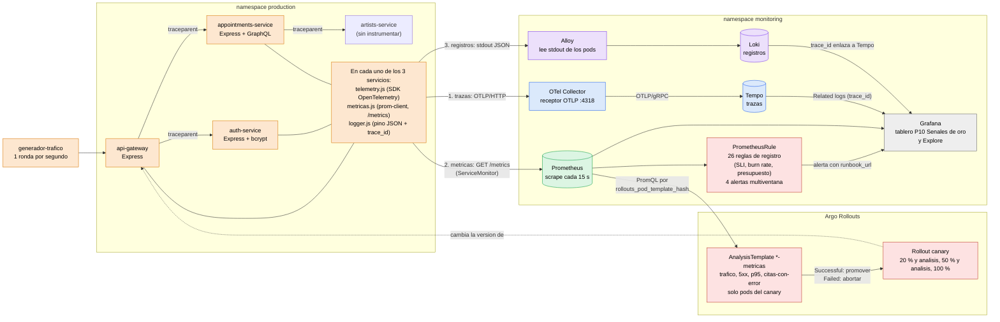

# Diagrama del flujo de telemetría: Práctica 10

Cómo viajan las tres señales (trazas, métricas y registros) desde los servicios hasta Grafana, y cómo las métricas gobiernan el canary. Todo el stack de observabilidad se despliega por GitOps (ArgoCD, repo `P8_GITOPS_202100239`).

**Leyenda:**

| Color | Significado |
|---|---|
| 🟧 Naranja | Servicios instrumentados en el namespace `production` |
| 🟦 Azul | Trazas (OpenTelemetry, OTLP) |
| 🟩 Verde | Métricas (Prometheus) |
| 🟪 Morado | Registros (JSON, Loki) |
| 🟥 Rojo | Decisiones automáticas: alertas y promoción o reversión del canary |
| ⬜ Gris | Visualización y consulta |

## Las tres señales y cómo se correlacionan

| Señal | Origen en el código | Transporte | Almacén | Llave de correlación |
|---|---|---|---|---|
| Trazas | `src/observabilidad/telemetry.js`: SDK de OpenTelemetry con autoinstrumentación (http, express, fetch, pg, graphql, amqplib) | OTLP/HTTP al Collector, OTLP/gRPC a Tempo | Tempo | `trace_id`, propagado entre servicios con la cabecera W3C `traceparent` |
| Métricas | `src/observabilidad/metricas.js`: histograma `http_request_duration_seconds`, contadores `citas_intentos_total` e `inicios_sesion_total` | Prometheus lee `/metrics` cada 15 s (ServiceMonitor) | Prometheus | Etiquetas `app` y `rollouts_pod_template_hash` (versión del pod) |
| Registros | `src/observabilidad/logger.js`: pino en JSON, un `mixin` copia el `trace_id` y el `span_id` del span activo | stdout, Alloy los recoge | Loki | `trace_id` y `span_id`, idénticos a los del span en Tempo |

## Recorrido de un síntoma a su causa

1. **Alerta:** Prometheus evalúa la tasa de quema del SLO y dispara `CitasPresupuestoQuemaRapida`, con su `runbook_url`.
2. **Traza:** en Grafana, Explore con Tempo y TraceQL `{ resource.service.name = "appointments-service" && status = error }`; la traza muestra `api-gateway → auth-service → appointments-service` y el span con error (`Status Message`).
3. **Registro:** el botón **Related logs** del span abre Loki filtrado por ese `trace_id`; el registro JSON trae el campo `error` con la causa.

## Cómo las métricas gobiernan el canary

Cada paso de análisis del Rollout crea un `AnalysisRun` a partir de la plantilla `<servicio>-production-metricas`. Las consultas filtran por `rollouts_pod_template_hash` del pod canary, así que miden **solo la versión candidata**. Se toleran 1 medición mala de 3 (`failureLimit: 1`); dos malas abortan el Rollout y el tráfico vuelve por completo a la versión estable.
