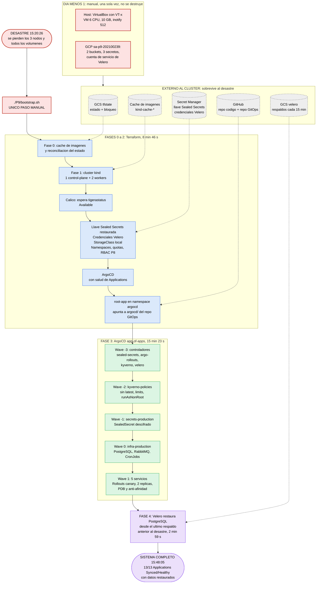

# Diagrama del bootstrap: Práctica 9

Orden de reconstrucción y dependencias entre componentes, desde la pérdida total del clúster hasta el sistema completo con sus datos. Los tiempos son los medidos en la reconstrucción cronometrada del 12/10/2026 (RTO total: 27 min 39 s).

**Leyenda:**

| Color | Significado |
|---|---|
| 🟥 Rojo | **Manual.** Solo dos acciones: los prerrequisitos de día menos 1 (una sola vez, nunca se destruyen) y ejecutar `./P9/bootstrap.sh` |
| 🟦 Azul | **Automático, Terraform** (estado remoto en GCS con bloqueo) |
| 🟩 Verde | **Automático, ArgoCD** (app-of-apps con sync waves) |
| 🟪 Morado | **Automático, Velero** (restauración de datos) |
| ⬜ Gris | **Externo al clúster.** Sobrevive al desastre |

Las flechas continuas indican **orden** (lo de abajo no empieza hasta que lo de arriba termina). Las punteadas indican **lectura de una dependencia externa**.

## Dependencias críticas

| Componente | Depende de | Qué pasa si no se respeta el orden |
|---|---|---|
| Calico | Clúster kind sin CNI propio | Sin red, ningún pod arranca, incluido ArgoCD |
| Llave de Sealed Secrets | Secret Manager | Si el controlador arranca **antes** de que exista, genera una llave nueva y los SealedSecrets del repo quedan ilegibles. Por eso la crea Terraform, antes de la app raíz |
| StorageClass `local` | Clúster | Con el tipo por defecto (`hostPath`), Velero omite los volúmenes **sin error**: los respaldos quedan sin datos |
| kyverno-policies (wave -2) | CRDs de Kyverno (wave -3) | Las políticas fallan porque su tipo no existe |
| secrets-production (wave -1) | Controlador de Sealed Secrets (wave -3) | El SealedSecret no se descifra |
| infra-production (wave 0) | Secret descifrado (wave -1) | PostgreSQL y RabbitMQ no arrancan sin sus contraseñas |
| 5 servicios (wave 1) | Argo Rollouts (wave -3) y PostgreSQL (wave 0) | Sin el CRD `Rollout` no se crean; sin base de datos no pasan `/health` |
| Restauración de datos (fase 4) | Velero (wave -3) y el StatefulSet de PostgreSQL (wave 0) | Velero en un clúster nuevo debe sincronizar primero los respaldos que ya existen en GCS |

## Qué es automático y qué es manual

- **Manual, una sola vez (día menos 1):** configurar el host y la VM, y crear en GCP los buckets, los secretos y la cuenta de servicio de Velero. Nada de esto se pierde en un desastre del clúster.
- **Manual, en cada recuperación:** **solo** ejecutar `./P9/bootstrap.sh`.
- **Automático:** todo lo demás, incluida la reconciliación del estado de Terraform cuando el clúster desaparece y la restauración de los datos.
